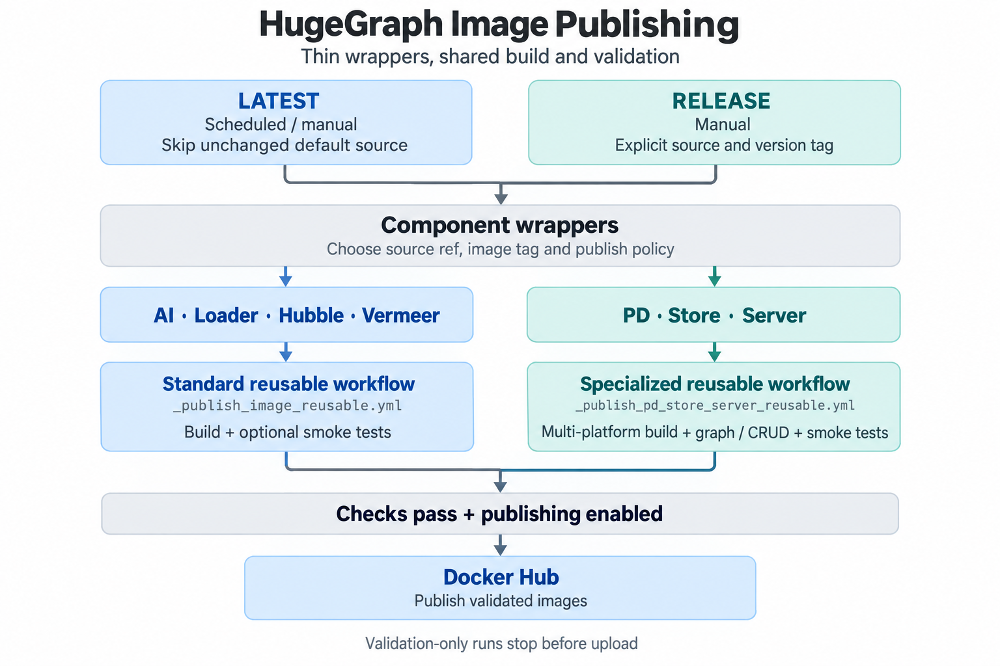
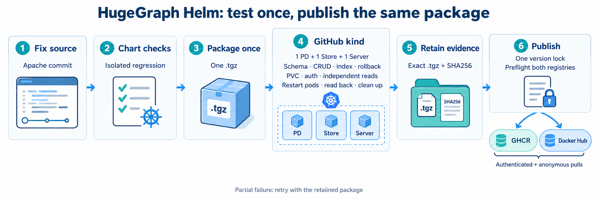
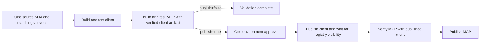

# HugeGraph Actions

Shared workflows for publishing HugeGraph Docker images, Helm charts and Python packages, validating releases, and repository automation.

## Image publishing architecture



Wrappers define when and what to publish; the two reusable workflows implement image building and validation. Each run resolves its source repository/ref to a fixed commit.

## Docker images

Thin component wrappers call either [the standard image publisher](.github/workflows/_publish_image_reusable.yml) or [the PD/Store/Server publisher](.github/workflows/_publish_pd_store_server_reusable.yml).

| Mode | Trigger | Source and tag | Unchanged source |
| --- | --- | --- | --- |
| Latest | Scheduled or manual | Default source uses `latest`; other refs can derive a tag or use `image_tag` | Skipped only for the configured default source without an explicit tag |
| Release | Manual | Explicit `source_ref`; standard images can derive the version, PD/Store/Server requires `image_tag=x.y.z` | Always runs |

Manual latest runs default to publishing (`publish=true`). Uncheck `publish` to build all configured platforms and read caches without pushing images, exporting caches, or updating `LAST_*_HASH`. Scheduled runs publish automatically. Use an explicit `image_tag` for branch builds.

Use `source_repository` to select the component's Apache or HugeGraph repository and `source_ref` for a branch, tag or commit. The resolved source SHA and destination `image_tag` are independent.

The standard publisher selects Dockerfiles, build contexts, platforms and optional smoke tests through `build_matrix_json`. Images carry OCI source/revision labels. Successful latest publications can update `LAST_*_HASH`.

### PD/Store/Server validation

```text
Resolve source SHA and tag
  → Build/load PD, Store, HStore Server and standalone Server (amd64 + arm64)
  → Run local compose, example graph and Gremlin CRUD checks
  → Smoke-test standalone Server
  → Push the same multi-platform candidates
  → Update latest hash, when enabled
```

Sources with `docker/bake.hcl` share one native Maven build and registry cache (`hugegraph/hugegraph:shared-<channel>`); older sources use the per-Dockerfile path. Compose uses `docker/docker-compose.dev.yml` with `pull_policy: never`, or the compatible `docker/docker-compose.yml` fallback.

The precheck imports the bundled `example.groovy`, verifies its 6 vertices/6 edges, and exercises Gremlin CRUD before returning to that baseline. Runtime checks use the locally loaded amd64 images. Only successful candidates are pushed, without rebuilding or temporary architecture tags.

The runner uses 1 PD + 1 Store + 1 Server, with 1 GiB each for PD/Store and 1.5 GiB for Server. These are CI limits, not production sizing. A full 3+3+3 topology requires a larger runner or another validated test setup.

### Multi-platform builds

Use `FROM --platform=$BUILDPLATFORM` for portable build stages so Maven/Node packaging runs natively; leave runtime stages on the target platform. Native libraries, JNI/CGO and architecture-specific downloads need cross-compilation or native target runners plus runtime tests. See [Docker's build strategies](https://docs.docker.com/build/building/multi-platform/) and [platform arguments](https://docs.docker.com/reference/dockerfile/#automatic-platform-args-in-the-global-scope).

## Helm charts

[`publish_helm.yml`](.github/workflows/publish_helm.yml) distributes `helm/hugegraph` (`Chart.name: hugegraph-helm`) from Apache HugeGraph **1.8.0+**. Manual runs default to validation and publication; pull requests validate merged Apache master without publishing.



| Input | Default | Meaning |
| --- | --- | --- |
| `source_ref` | `master` | Apache branch, tag or commit; resolved once to a commit |
| `channel` | `dev` | Append `-dev.<run_number>`, or use the source Chart version for `release` |
| `publish` | `true` | Publish after validation; disable to retain a tested package only |

Chart versions are independent: Chart `0.2.1` can deploy HugeGraph `1.8.0`. Development packages allow `latest` images. Formal packages require a published, non-prerelease service Release, `appVersion >= 1.8.0`, released component versions or digests, and fixed images for every rendered container. Hubble has its own version. Maintain versions in source; CI does not rewrite formal versions. Formal commits must belong to Apache master history, allowing later Chart fixes after a service release.

**Validation.** Source-controlled lint, preset rendering, packaging regressions and Chart unit tests run in an isolated job without publication credentials. A clean workspace packages once, then installs that exact `.tgz` on a GitHub runner: 1 PD + 1 Store + 1 Server, PVCs enabled, Hubble disabled, memory bounded to 1/2/2 GiB. Checks cover readiness, mounted PVC writes, authentication, schema definitions, vertex/edge CRUD, index queries, rollback and independent-request reads. Store/Server Pod recreation must preserve committed data; cleanup is verified. These are smoke-test limits, not production sizing or HA coverage. Any failure blocks publication.

Tools use pinned SHA256 checksums. CI resolves component and helper images to digests, records runtime evidence and uses those digests for testing. Published Chart image references remain unchanged: version tags can move, so configure source values with digests when consumers need identical image content.

**Publication and recovery.** One lock per Chart/version covers both registries. Preflight checks both before uploading; differing existing content or registry errors block writes. Matching copies are skipped. Both authenticated and anonymous pulls must match the original package SHA256 and metadata. Registries have no shared transaction: a later failure can leave one published copy. **Re-run failed jobs** to complete publication with the original bundle, retained for 30 days subject to repository policy. An expired/deleted artifact fails recovery; use a new development run or source-maintained formal version.

**Setup.** Pre-create public Docker Hub repository `hugegraph/hugegraph-helm`; `DOCKERHUB_USERNAME` and `DOCKERHUB_PASSWORD` need write access. GHCR uses `GITHUB_TOKEN` with `packages: write`; grant `hugegraph/actions` access to an existing package. After first upload, an administrator makes GHCR Public, then re-runs the failed publisher. Later versions work with organization-wide Public package creation disabled.

Use GHCR for public CI; Docker Hub is the alternative. Select an actually published version:

```bash
helm pull oci://ghcr.io/hugegraph/hugegraph-helm --version 0.2.0-dev.6
helm install hugegraph oci://ghcr.io/hugegraph/hugegraph-helm --version 0.2.0-dev.6
helm pull oci://registry-1.docker.io/hugegraph/hugegraph-helm --version 0.2.0-dev.6
```

Register `oci://ghcr.io/hugegraph/hugegraph-helm` in [Artifact Hub](https://artifacthub.io/docs/topics/repositories/helm-charts/).
Run [Publish Helm repository metadata](.github/workflows/publish_helm_metadata.yml) to publish the repository ID for Verified Publisher.
The workflow checks an identical anonymous download. It writes only the separate `artifacthub.io` tag, leaving Chart versions intact.
Artifact Hub enables the label after processing the repository; Official status requires a separate request.

Offline users can install the pulled `.tgz` directly or `helm push` it into an OCI registry.
HTTP repositories require their upload mechanism and `index.yaml`.
Mirror container images separately and override their addresses; the Chart archive contains no images.

Local helper checks require no Docker or upload:

```bash
python3 -m unittest discover -s tests -p 'test_helm*.py' -v
bash tests/test_publish_prepare.sh
actionlint .github/workflows/publish_helm.yml .github/workflows/publish_latest_*.yml
```

## Python packages

[`publish_python.yml`](.github/workflows/publish_python.yml) builds and validates the client and MCP in one run by default, with opt-in publishing. A thin dispatcher calls [one reusable build workflow](.github/workflows/_build_python_reusable.yml) for each component. One publish job handles all selected uploads after a single environment approval.

| Input | Default | Meaning |
| --- | --- | --- |
| `component` | `both` | `both` runs client then MCP; `client` or `mcp` runs one component |
| `source_repository` | `apache/hugegraph-ai` | Choose the Apache repository or `hugegraph/hugegraph-ai` for pre-merge validation |
| `publish` | `false` | Validate and retain artifacts; enable explicitly to upload |
| `source_ref` | `main` | Branch, tag or SHA; resolved to an immutable commit |
| `target` | `testpypi` | `testpypi` or `pypi`; both accept a source branch, tag or SHA |
| `test_version` | Empty | Shared client/MCP version for TestPyPI, e.g. `1.7.1.1`; must be empty for PyPI |

Test versions use `x.y.z.n`, extending the source version with a fourth number only in the CI checkout. Choose a new number when testing changed code; there is no automatic numbering. Production reads `x.y.z` directly from the selected source commit's metadata, with no version override or tag requirement. Four-part versions are a convention for TestPyPI, not Python prerelease markers.

Fork sources (`hugegraph/hugegraph-ai`) can be validated with `publish=false` or published to TestPyPI. Public PyPI uploads require `apache/hugegraph-ai`; the publisher rejects fork sources before network access or uploading.

All selected artifacts are built and tested before approval. With `both`, MCP first uses the client wheel built and tested in that same run, verified against its source SHA and manifest hash. Validation runs (`publish=false`) stop there and never request an environment approval or receive an upload token. This checks the package pair without requiring an existing client release; it is not a registry-install check. A single-component MCP build still requires a published client.

Create environments `testpypi` and `pypi`, each containing `PYPI_API_TOKEN`. Restrict `pypi` deployments to the `master` branch of this repository and require maintainer approval with admin bypass disabled; `testpypi` allows branch validation. This restriction applies to the workflow branch, not the source package ref. Only the two upload steps receive the selected token. The single publish job requests one environment approval for the selected package or pair; self-initiated runs keep the same approval requirement. Each token must authorize the selected package; a token scoped only to `hugegraph-python` cannot publish `hugegraph-mcp`.



The build job uses uv, checks wheel/sdist with Twine, records their hashes, and runs isolated wheel/sdist installations on Python 3.10/3.11. Client releases run unit/contract tests against the installed package. MCP releases first run the source revision's client vertex-ID, schema and distribution contract tests against the downloaded client in each isolated environment; only the three test files are copied, with no client source or repository pytest configuration. They then run the source revision's `hugegraph-mcp/tests/distribution_smoke.py` against each installed console entry point and a fresh `uvx --from <wheel> hugegraph-mcp` process; it checks MCP initialization, tool discovery, inspect and query calls against an HTTP fixture without requiring a live HugeGraph server. It verifies the artifacts again after tests. The publish job checks the manifest and remote filenames/hashes before uploading those exact artifacts. Unexpected remote files or conflicting hashes fail; identical files are skipped. For partial uploads, **re-run failed jobs** to reuse the original artifacts.

### Client and MCP release order

Choose `both` to resolve the source only once, check that client/MCP versions match, then build/test client before building MCP with that tested artifact. A build failure stops publication. After one approval, the publish job uploads client, waits for the exact version's wheel and sdist to appear, revalidates the unchanged MCP artifacts against the published client, then uploads MCP. Single-component options remain available for focused validation or recovery.

For publication to `pypi`, MCP dependencies come from **public PyPI**; `both` pins the client to the version just published. For publication to `testpypi`, MCP uses the exact client wheel matching `test_version`, fetched through a hash-pinned direct URL. All other dependencies come from public PyPI, without mixed-index lookup. The pre-approval `both` build uses the same-run client artifact instead. These dependency paths are identified in the run logs.

1. Select `component=both`, one source ref containing both packages, and the target index. For TestPyPI, supply one shared `test_version` such as `1.7.1.2`; leave it empty for PyPI.
2. Leave `publish` unchecked to test both packages without uploading anything.
3. Enable `publish` to run the client upload, registry visibility check, MCP validation and MCP upload in sequence. One environment approval covers both uploads; the token is absent from the intervening MCP validation step.
4. If the client is published but MCP fails, re-run failed jobs to retain the original artifacts. A separate `mcp` run can also validate/release the same source version without rebuilding the client; do not rebuild already-published artifacts and expect to overwrite them.
5. After public PyPI publication, verify `uvx --no-config --no-cache --index-url https://pypi.org/simple hugegraph-mcp@1.7.1` outside any checkout with the documented HugeGraph connection settings. Workflow smoke checks use an HTTP fixture; verify a real service separately.

For `1.8.0`, update the package versions and MCP's client dependency lower bound in the AI repository, then repeat this order. Published versions are immutable. Use `target=testpypi` and an explicit four-part `test_version` to test uploads without occupying a PyPI version.

<details>
<summary>Development checks</summary>

Local checks (no upload):

```bash
uv run --no-project --python 3.11 python -m unittest discover -s tests -p 'test_python_release.py' -v
actionlint .github/workflows/publish_python.yml .github/workflows/_build_python_reusable.yml
```

</details>

Once a workflow is registered in GitHub Actions, manual runs can select a workflow branch with `gh workflow run --ref`. A first PR validation run can register this Helm workflow before it reaches the default branch.

## Maintenance

Browse the [workflow directory](.github/workflows) for component entry points. Keep trigger policy and component settings in wrappers, shared build behavior in reusable workflows, and preserve the distinct latest/release semantics. Use dedicated workflows for different validation or sequencing requirements.
