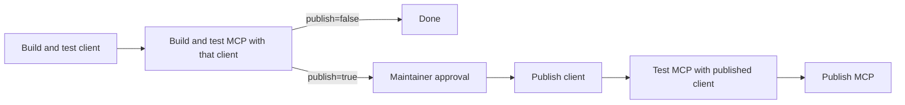

# HugeGraph Actions

Shared workflows for publishing HugeGraph Docker images, Helm charts and Python packages, validating releases, and repository automation. Start the publishing workflows below with **Run workflow** in GitHub Actions.

## Docker images


| Component | Development images | Release images |
| --- | --- | --- |
| PD / Store / Server | [Latest](.github/workflows/publish_latest_pd_store_server_image.yml) | [Release](.github/workflows/publish_release_pd_store_server_image.yml) |
| AI | [Latest](.github/workflows/publish_latest_ai_image.yml) | [Release](.github/workflows/publish_release_ai_image.yml) |
| Hubble | [Latest](.github/workflows/publish_latest_hubble_image.yml) | [Release](.github/workflows/publish_release_hubble_image.yml) |
| Loader | [Latest](.github/workflows/publish_latest_loader_image.yml) | [Release](.github/workflows/publish_release_loader_image.yml) |
| Vermeer | [Latest](.github/workflows/publish_latest_vermeer_image.yml) | [Release](.github/workflows/publish_release_vermeer_image.yml) |

| Mode | Trigger | Behavior |
| --- | --- | --- |
| Latest | Scheduled or manual | Publishes by default; skips unchanged sources only for the default source without an explicit tag |
| Release | Manual | Always runs; PD/Store/Server requires an explicit `image_tag=x.y.z` |

Choose `source_repository` and `source_ref` to select the code to build. Set `image_tag` explicitly for branch builds. On a manual latest run, uncheck `publish` to build and validate without publishing images, writing caches or updating the latest-source marker.

PD/Store/Server builds amd64 and arm64 images, then runs Compose and graph CRUD checks using the built amd64 images before publishing. Its smoke tests use 1 PD + 1 Store + 1 Server; they do not validate a production HA deployment. Sources with `docker/bake.hcl` share one Maven build; older sources use the per-Dockerfile path.

## Helm charts

[Publish HugeGraph Helm](.github/workflows/publish_helm.yml) packages `apache/hugegraph`'s `helm/hugegraph` directory for HugeGraph **1.8.0 and later**. The Chart is named `hugegraph-helm`.


| Input | Default | Meaning |
| --- | --- | --- |
| `source_ref` | `master` | Apache branch, tag or commit to package |
| `channel` | `dev` | `dev` adds `-dev.<run_number>`; `release` uses the source Chart version |
| `publish` | `true` | Publish after validation; uncheck to test and retain the package only |

Chart and service versions are independent: Chart `0.2.1` can deploy HugeGraph `1.8.0`. Development packages allow `latest` images. Release packages require an already released service, fixed container images and a source commit in Apache master history. Maintain release versions in source; CI does not rewrite them.

CI checks the Chart, packages it once, and installs that same `.tgz` on a GitHub runner with **1 PD + 1 Store + 1 Server**, persistent storage enabled and Hubble disabled. Tests cover authentication, schema and graph CRUD, queries, and data survival after Pod recreation. Failures block publication. Pull requests run validation without publishing.

The tested package goes to GHCR and Docker Hub, followed by anonymous download checks. Identical existing packages are skipped; conflicting contents fail. If either registry fails, use **Re-run failed jobs** to finish with the original package.

For development testing:

```bash
helm install hugegraph oci://ghcr.io/hugegraph/hugegraph-helm --devel
helm pull oci://ghcr.io/hugegraph/hugegraph-helm --devel
```

`--devel` includes prereleases when selecting the latest version; it does not select development packages exclusively. Use `--version <chart-version>` to pin a package. Docker Hub is also available at `oci://registry-1.docker.io/hugegraph/hugegraph-helm`.

See the [Chart README](https://github.com/apache/hugegraph/blob/master/helm/hugegraph/README.md) for deployment, configuration and offline use. The Chart archive contains no container images; mirror those separately for offline deployments.

## Python packages

[Publish HugeGraph Python](.github/workflows/publish_python.yml) builds and tests the client and MCP together by default. Publishing is opt-in.

| Input | Default | Meaning |
| --- | --- | --- |
| `component` | `both` | Build the client and MCP together, or select `client` / `mcp` |
| `source_repository` | `apache/hugegraph-ai` | Apache source or `hugegraph/hugegraph-ai` for fork validation |
| `source_ref` | `main` | Source branch, tag or commit |
| `target` | `testpypi` | Package index: `testpypi` or `pypi` |
| `test_version` | Empty | Shared TestPyPI version, such as `1.7.1.1`; leave empty for PyPI |
| `publish` | `false` | Enable to upload after tests and environment approval |

For a trial run, choose `both`, `testpypi`, and a new four-part `test_version`. Leave `publish` unchecked to test without uploading. For PyPI, select Apache source and leave `test_version` empty; versions come from source. Fork sources can publish only to TestPyPI.



With `both`, client and MCP versions must match. One approval covers both uploads. An MCP-only run needs an already published client.

If publication stops partway through, use **Re-run failed jobs** to reuse the tested artifacts. Published versions cannot be overwritten. MCP smoke tests use an HTTP fixture; check the published package against a real HugeGraph service before production use.

## Maintenance

See [workflow maintenance](docs/workflow-maintenance.md) for registry access, recovery limits, build conventions and local checks. Keep component settings in entry workflows and shared behavior in the reusable [image publisher](.github/workflows/_publish_image_reusable.yml), [PD/Store/Server publisher](.github/workflows/_publish_pd_store_server_reusable.yml), and [Python builder](.github/workflows/_build_python_reusable.yml).

Other entry points include [release validation](.github/workflows/validate-release.yml), [Artifact Hub metadata](.github/workflows/publish_helm_metadata.yml), and the remaining [workflows](.github/workflows).
